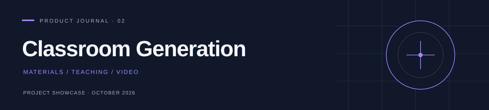
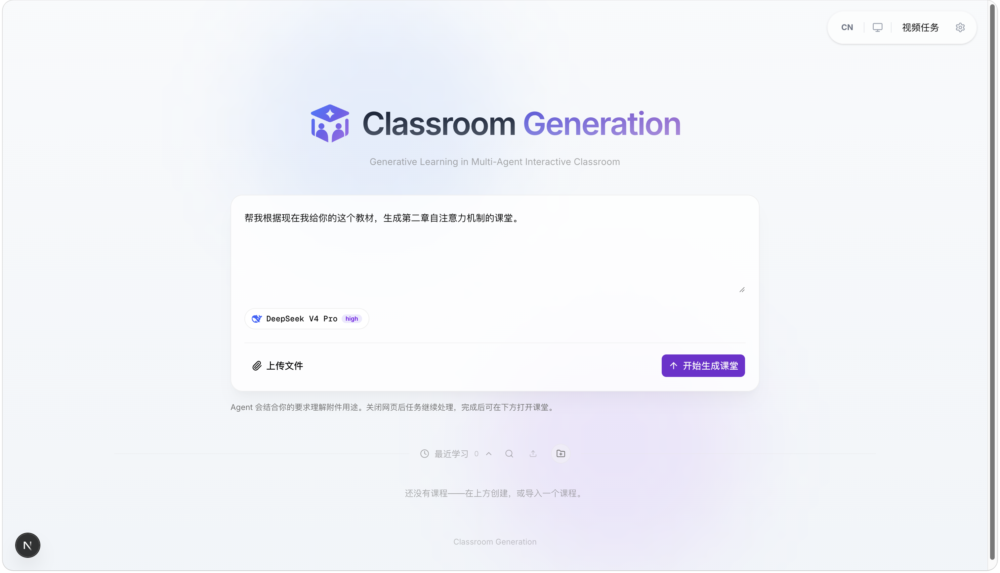
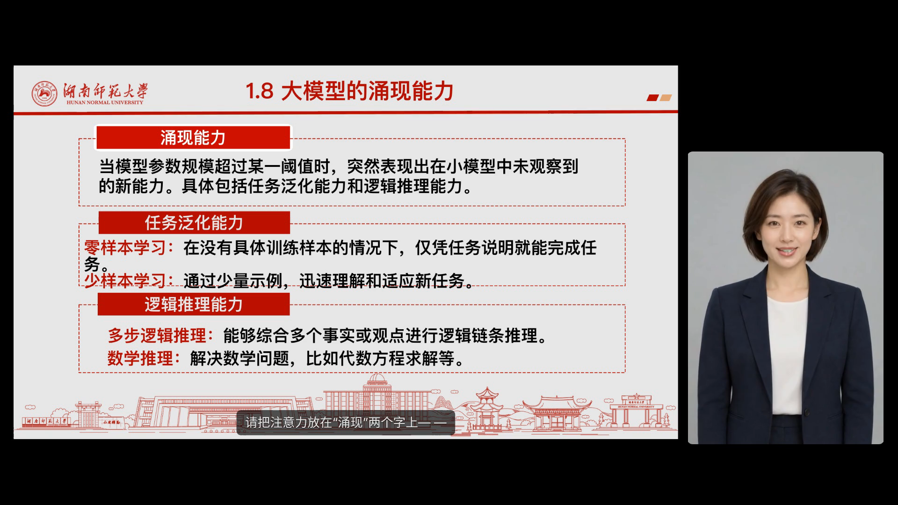
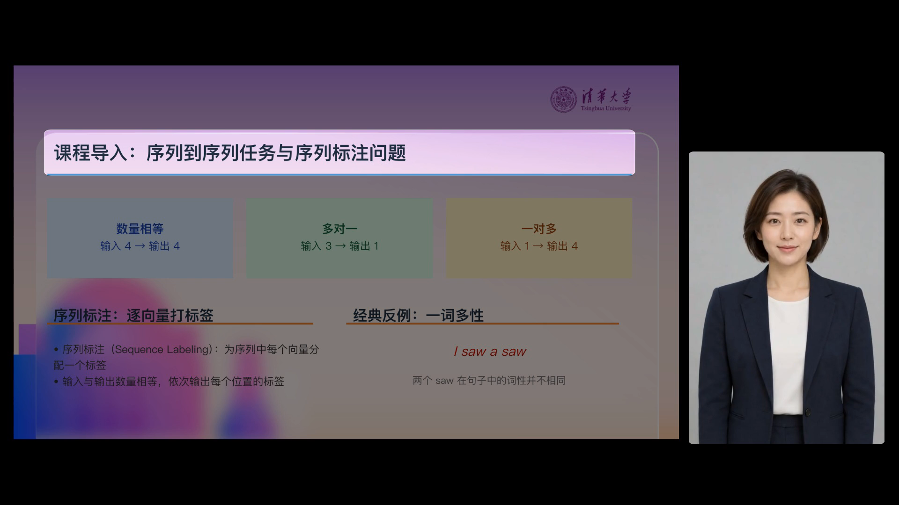
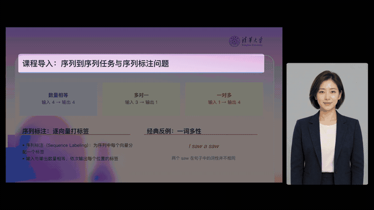

  

<h1 align="center">Classroom Generation · 数字人课堂生成</h1>

<strong>让教学材料成为可讲解、可编辑、可交付的课程。</strong>

项目介绍 · 课堂实例 · V3 开发方向 2026 年 10 月 14 日 · 公开展示仓库，项目实现闭源

  <a href="#01-从材料到课堂">产品</a> ·
  <a href="#02-真实课堂实例">实例</a> ·
  <a href="#03-我们解决什么问题">价值</a> ·
  <a href="#04-v3让完整-agent-拥有制作能力">V3</a> ·
  <a href="#05-加入-minimax-h3-之后课堂可以怎样变化">前景</a>

---

## 01 从材料到课堂

一份教材或一套课件，离一节能够观看的课程还有很长的距离：需要组织讲解、补充例子、安排重点、录制声音，再将课件、字幕与教师画面放到同一条时间线上。

**Classroom Generation 将这些工作连接在一个课程制作系统里。** 用户上传教学材料，用自然语言说明章节、受众和讲解要求；系统围绕材料组织课堂内容，并将课件、教学动作、配音和数字人画面组合成课程成果。教师可以继续调整内容，也可以将课程导出为视频，用于课前学习、章节复习和教学展示。

  

图 7 · 当前课堂生成入口。通过教学要求与附件发起制作，后台任务与课程记录承接后续工作。已精确裁去浏览器栏。

### 围绕课程组织能力

| 能力 | 用户可以做什么 | 对教学制作的意义 |
| :--- | :--- | :--- |
| 教学材料输入 | 上传教材、文档与课件，用自然语言指定其用途 | 让讲解围绕已有教学材料展开 |
| 已有课件讲解 | 导入课件，在支持的页面结构上组织讲稿和教学动作 | 复用教师积累的内容，而非每次从零制作 |
| 内容与版式调整 | 在已支持的模板和页面元素上填充内容、修订指定页 | 保留可编辑内容，方便后续更新 |
| 课堂呈现 | 使用课件、讲解、重点聚焦与激光笔等呈现手段 | 让学生知道正在讲哪一处、应该看哪里 |
| 声音与教师画面 | 为讲解配音，结合数字人形象制作教师片段 | 形成具有讲述者的课程观看体验 |
| 后台制作 | 查看任务进展，处理失败与重试；受理后的任务不依赖网页持续打开 | 让较长的制作过程能够持续进行 |
| 视频交付 | 将课件画面、音频及可选教师片段合成为 MP4 | 便于离线观看、分享与课程归档 |

当前项目已经形成材料处理、课程编辑与媒体制作的主要能力，并有下方两段实际课堂视频。不同文件的解析和版式支持有范围差异；复杂课件的视觉保真、所有教学动作的导出一致性，以及长课程的稳定性仍需按具体材料检查。

## 02 真实课堂实例

两段视频均由用户提供，作为项目生成的课堂例子公开展示。这里保留完整 MP4；动图只是各自从第 25 秒开始截取的 6 秒无声片段。观看声音、连续讲解和翻页，请下载完整视频。

| 大模型的涌现能力 | 序列到序列任务与序列标注 |
| :---: | :---: |
|  |  |
| **08:04 · 1920 × 1080 · 含音轨** | **05:09 · 1920 × 1080 · 含音轨** |
| [下载完整课堂一](https://github.com/maolinqi/Classroom-Generation-Showcase/releases/download/showcase-20261014/classroom-example-1.mp4) | [下载完整课堂二](https://github.com/maolinqi/Classroom-Generation-Showcase/releases/download/showcase-20261014/classroom-example-2.mp4) |

  

实例一 · 课件与数字人并列呈现，字幕承接讲解，画面中可见重点指示。

  

实例二 · 利用局部聚焦引导阅读，将讲解与页面中的具体内容关联。

这两段实例展示了本项目最核心的交付形态：**有课件、有讲解、有教师画面，也有面向内容的视觉引导。** 视频中的课件标识属于其原始材料，不表示有关机构对本项目的合作或背书。视频分辨率是最终合成画面的规格，不等于数字人模型的原生输出分辨率。

## 03 我们解决什么问题

现有工具已经能分别生成文字、声音或人物视频。课程制作的难点在于把这些结果组织成一致、可修改的教学内容。下表比较的是常见制作方式的结构性取舍，并非对所有产品的统一评价，也不是未经测量的性能排名。

| 常见制作方式与局限 | 本项目的做法 | 实际价值 |
| :--- | :--- | :--- |
| 教师录屏与后期剪辑需要反复录制；改一段讲解可能牵动多项素材 | 将页面内容、讲稿、教学动作与媒体素材分别组织 | 为局部修订和素材复用保留基础 |
| 通用“会说话的人像”能呈现讲述者，但不会自动建立课件重点与讲解的关系 | 将人物视频放进课程时间线，结合页面及教学动作 | 内容和教师画面共同服务于讲解 |
| 单纯将整页文字转成语音，容易缺少例子、节奏和重点引导 | 围绕教学材料组织讲稿与页面动作 | 为解释知识提供比逐字朗读更丰富的表达方式 |
| 一次性生成容易只留下最终视频，后续修订成本高 | 保留可编辑课程、实际输入和媒体任务记录 | 便于追踪内容来源与继续制作 |
| 长视频失败后重新生成全部素材，可能重复消耗时间与算力 | 保存已完成片段，按实际输入匹配进行复用和合成恢复 | 已完成工作可以成为下一次处理的基础 |

**我们的优势集中在课程组织和制作工程。** 项目将已有课件引擎、语言模型、配音、数字人和渲染能力连接起来，让“怎样讲清楚”和“怎样完成交付”进入同一个工作过程。单个模型的能力升级能够被吸收到系统中，而不必替换整套课程制作方式。

现阶段仍有需要正视的限制。语言模型产生的事实、例子和教学逻辑需要教师审阅；PPTX 导入并不能保证所有字体、动画与特殊版式完全还原；数字人的口型和表情质量受模型及输入素材影响；长课程最终合成仍可能成为时间瓶颈。现有实例证明了具体课堂能够交付，尚不能证明所有教材都能无人工干预地稳定生成，也没有证明学习效果优于真人授课。

## 04 V3：让完整 Agent 拥有制作能力

V3 正在开发。它的方向是：**保留完整官方 DeepSeek Harness，让通用 Agent 获得课件、配音和视频制作能力。** 原有对话、模型设置、文件操作、规划、任务通知与权限机制继续使用官方应用；制作能力以独立插件接入。[DeepSeek Harness 官方项目](https://github.com/deepseek-ai/deepseek-harness)

### 三个能力入口，自主组织任务

| 制作能力 | 承担的工作 | 可以独立使用的例子 |
| :--- | :--- | :--- |
| `slides` · 课件 | 导入、版式处理、局部编辑与课件导出 | “只修改这两页，保留其余内容。” |
| `speech` · 配音 | 为文本配音、选择已配置声音、取得或复用录音 | “先给这段讲稿配音，我要听一下节奏。” |
| `video` · 视频 | 使用课件、已有录音和可选数字人素材制作视频 | “用现成课件和我上传的录音制作课程。” |

三个入口之间没有强制调用顺序。用户可以讨论课程，也可以直接制作；可以只要课件、只要配音，或者使用已有课件与录音合成视频。Agent 根据当前请求和已有文件选择能力，制作引擎负责实际执行与格式处理。

### 让制作可以延续

V3 将耗时的配音和视频制作交给独立执行服务，保存实际输入、任务标识、执行状态与输出。官方任务记录承接观察和完成通知。设计目标是：用户关闭窗口或切换对话后，已受理的媒体工作仍有明确去向；回来时可以找回任务和真实成果，继续调整下一版。

这种延续性来自制作服务与插件的衔接。官方原生任务记录本身不能代替持久存储，也不能被当作媒体一定完成的证明。课程、录音和视频的修改由 Agent 与用户共同推进，最终交付依据实际文件。

例如，教师先要求生成一份讲义，随后补充：“这个例子太抽象，换成学生熟悉的情境。”Agent 可以修改内容，再按需重新配音或制作视频；如果教师已有满意的录音，就直接使用已有录音。用户可以逐步完善课程，每次请求只调用所需能力。

**当前进展：** 三个制作入口、后端适配、媒体任务衔接及独立运行入口已写入源码。实际配置迁移、插件安装启用、部署和完整运行验收尚未完成。这里展示的是正在开发的实现思路，图 7 和两段课堂视频均不作为 V3 已发布的证明。

## 05 加入 MiniMax H3 之后，课堂可以怎样变化

当前课堂通过课件画面、讲解声音与数字人片段组成视频。下一步有价值的升级，是为需要动态解释的知识点引入更丰富的生成画面。

MiniMax H3 官方资料描述了文本、图像、视频和音频参考输入，以及联合音视频生成能力；其单段输出范围为 4–15 秒。官方本地 Base 路径与完整 2K 路径存在差异，完整高分辨率流程涉及额外模块或服务。[MiniMax H3 官方说明](https://github.com/MiniMax-AI/MiniMax-H3)

**以下是本项目对接这类模型的应用设想，尚未完成集成或效果验证。**

### 从页面讲解走向动态示范

对于必须准确呈现的定义、公式、图表和代码，继续使用可控的课件渲染。对于适合视觉化的过程，则可以探索生成短场景：用流体运动辅助解释现象，用物体交互演示因果关系，用生活情境承接抽象概念。动态素材与精确课件结合，有望增加课程的表达选择。

### 让教师拥有更丰富的表达空间

参考图像、声音和场景信息，可以成为探索教师短片的输入：教师出现在适合课程的环境中，进行更丰富的姿态与情境表达。是否能够保持人物一致、说准课程文本、对齐动作与教学目标，需要逐项验证；指定手势和精确指向不能仅凭生成画面的自然程度判断成功。

### 用短镜头组织长课程

课程长度往往远超单次视频生成长度。合理的接入方式是让 Agent 围绕知识点选择短镜头，检查结果，再由现有制作系统安排讲解、字幕、课件与镜头的时间关系。这样可以从局部开始升级，也为失败片段替换和后续修订留出空间。

| 发展方向 | 可能带来的体验 | 成立所需的条件 |
| :--- | :--- | :--- |
| 动态知识示范 | 把难以想象的过程变成可观察片段 | 检查科学正确性，防止画面引入错误因果 |
| 情境化讲解 | 为案例和概念提供具体场景 | 控制素材与教学内容的相关性 |
| 更丰富的教师表现 | 增加教师姿态、镜头和环境选择 | 验证身份、声音与多片段连续性 |
| 多版本课程制作 | 为不同受众调整例子、深度和表达 | 保留教师审阅及实际素材的版本关联 |
| 更高质量的视频交付 | 探索更精细的教师与场景画面 | 明确模型路径、算力、时间与服务依赖 |

这类升级仍需解决准确讲稿、专业术语、人物连续性、长视频衔接与生成成本等问题。特别是公式、细小文字和复杂图表，应由可控渲染承担；原生音视频生成也不能自动保证逐字准确的授课音频。本项目目前未发布 H3 课堂样例，也未给出未经测量的速度、成本或画质提升数字。

## 06 长期价值：可以持续积累的课程资产

面向高校课程、教师备课、企业培训和知识讲解，长期价值来自课程能够被持续维护。教材更新后，教师可以调整相应页面与讲稿；课程面对不同学生时，可以改变解释深度和例子；媒体模型升级后，可以尝试替换需要提升的教师片段或动态素材。

我们的发展方向是将课件、讲稿、配音与视频保留为可继续使用的教学资产，再由具备制作能力的 Agent 协助组织和更新。个性化版本、跨语言制作和课程资产检索是后续值得探索的方向，仍需分别完成模型接入、质量审阅及真实使用评估。

课堂生成负责内容制作与交付；[灵影](https://github.com/maolinqi/LingYing-Showcase) 面向对话、声音与数字人交互，英文以 LingYing Live 和 LingYing Studio 区分对话与视频制作方向。两者服务不同的使用场景，共享能力通过独立适配接入，各自保留运行和数据边界。

---

### 展示范围与技术来源

本仓库只发布介绍、界面素材与课堂实例，不公开本项目实现源码、模型权重、部署配置、用户数据或凭据。公开展示不改变第三方组件的许可义务，也不授予其中教材、标识或人物素材的额外使用权。详见 [展示素材与权利说明](NOTICE.md)。

课堂基础能力基于 [THU-MAIC/OpenMAIC](https://github.com/THU-MAIC/OpenMAIC)，数字人制作使用 [SoulX-FlashHead](https://github.com/Soul-AILab/SoulX-FlashHead) 等现有能力；V3 采用 [DeepSeek Harness](https://github.com/deepseek-ai/deepseek-harness) 扩展机制。各组件的能力与许可归其原作者；本项目介绍的工作集中在独立适配、课程编辑、后台制作与交付组织。

Classroom Generation · 从材料出发，让课程持续生长。

